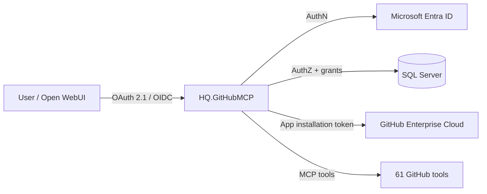
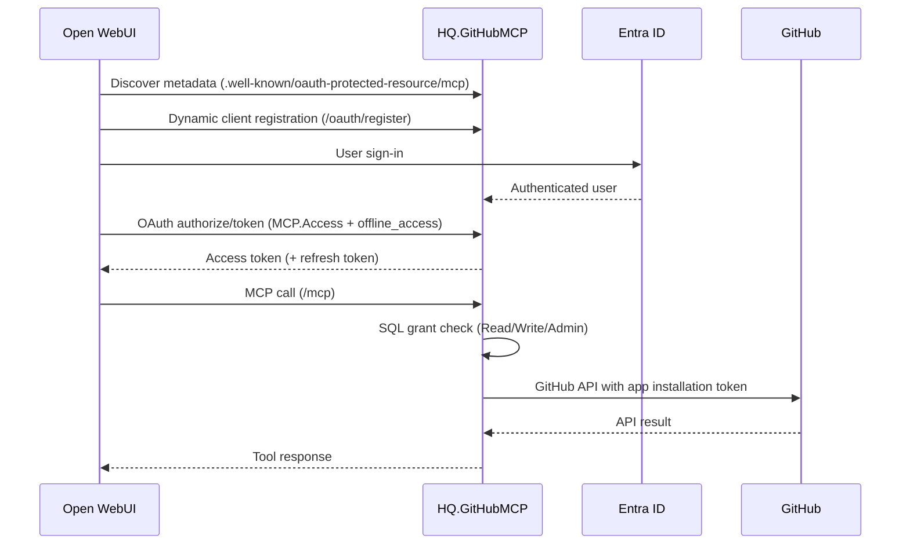
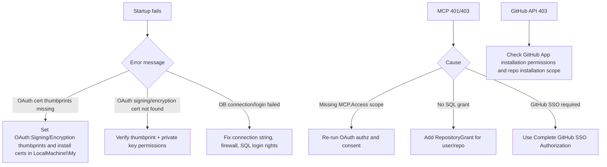

# HQ.GitHubMCP Installation Guide

> This guide walks through a **complete setup** of HQ.GitHubMCP for development and production-style deployment.
> It is written to reduce confusion with explicit prerequisites, checklists, and validation steps.

---

## 1) What you are installing

HQ.GitHubMCP is an MCP server that:
- Authenticates users with **Microsoft Entra ID**
- Authorizes access with **SQL Server RBAC**
- Calls GitHub through a **GitHub App** (and supports OAuth connection for user identity/SSO workflows)
- Exposes MCP tools at `/mcp` protected by OAuth 2.1 bearer tokens (`MCP.Access` scope)

---

## 2) Architecture (high level)



---

## 3) End-to-end auth flow



---

## 4) Prerequisites checklist

- [ ] Windows server/workstation with .NET SDK (matching project target)
- [ ] SQL Server database created
- [ ] Microsoft Entra app registration configured
- [ ] GitHub App created and installed in target org
- [ ] OAuth signing + encryption certs installed in **LocalMachine\\My** (with private keys)
- [ ] DNS + HTTPS certificate for your MCP host (example: `https://hq-githubmcp.bfsaul.net`)

---

## 5) SQL Server setup

### 5.1 Create database
Create a SQL Server database (example `HQGITHUBMCP`) and a least-privileged app login.

### 5.2 Apply schema using reviewed migration script (recommended)
From repository root:

```powershell
dotnet tool install --global dotnet-ef --version 10.0.0
dotnet ef migrations script --idempotent --project src/HQ.GitHubMCP -o HQ_GitHubMCP.sql
```

Review `HQ_GitHubMCP.sql`, then deploy using your normal change process.

> Do not rely on automatic migrations in production.

---

## 6) Microsoft Entra ID setup

Create or verify an Entra app registration for the web app sign-in:

- Redirect URI: `https://<your-host>/signin-oidc`
- App should support your tenant users
- Configure certificate credentials (PFX/CER) used by Microsoft.Identity.Web

You will set these in config:
- `AzureAd:Instance`
- `AzureAd:Domain`
- `AzureAd:TenantId`
- `AzureAd:ClientId`
- `AzureAd:CallbackPath` (usually `/signin-oidc`)
- `AzureAd:ClientCredentials` (certificate path/password)

---

## 7) GitHub App setup

Create a GitHub App in your enterprise/org and install it on allowed repositories.

Required config values:
- `GitHub:AuthenticationMode` = `GitHubApp`
- `GitHub:WebBaseUrl` (enterprise web URL)
- `GitHub:ApiBaseUrl` (enterprise API URL)
- `GitHub:AppId`
- `GitHub:InstallationId`
- `GitHub:PrivateKeyPath` (PEM private key)
- `GitHub:AllowedOrganization`
- `GitHub:ClientId` / `GitHub:ClientSecret`
- `GitHub:CallbackUrl` = `https://<your-host>/github/callback`
- `GitHub:Organization` (used by SSO completion URL)

---

## 8) OAuth certificates for MCP authorization server (critical)

HQ.GitHubMCP requires **two certificate thumbprints** at startup:
- `OAuth:SigningCertificateThumbprint`
- `OAuth:EncryptionCertificateThumbprint`

These certs must exist in:
- Store: `LocalMachine`
- Name: `My`
- With accessible private keys

If missing, app startup fails.

---

## 9) Configure `appsettings.json` (single source of truth)

> Keep secrets out of source control. Use user-secrets, environment variables, or secure vault for production.

Use this structure (example with placeholders):

```json
{
  "ConnectionStrings": {
	"DefaultConnection": "Server=<sql>;Database=<db>;User Id=<user>;Password=<pwd>;Encrypt=True;TrustServerCertificate=true;"
  },
  "OAuth": {
	"Issuer": "https://<your-host>/",
	"SigningCertificateThumbprint": "<thumbprint-1>",
	"EncryptionCertificateThumbprint": "<thumbprint-2>"
  },
  "AzureAd": {
	"Instance": "https://login.microsoftonline.com/",
	"Domain": "<tenant-domain>",
	"TenantId": "<tenant-id>",
	"ClientId": "<client-id>",
	"CallbackPath": "/signin-oidc",
	"ClientCredentials": [
	  {
		"SourceType": "Path",
		"CertificateDiskPath": "<path-to-pfx>",
		"CertificatePassword": "<pfx-password>"
	  }
	]
  },
  "GitHub": {
	"AuthenticationMode": "GitHubApp",
	"EnterpriseName": "<enterprise-name>",
	"EnterpriseSlug": "<enterprise-slug>",
	"WebBaseUrl": "https://<enterprise>.ghe.com/",
	"ApiBaseUrl": "https://api.<enterprise>.ghe.com/",
	"AppId": "<app-id>",
	"InstallationId": "<installation-id>",
	"PrivateKeyPath": "<path-to-app-private-key.pem>",
	"AllowedOrganization": "<org>",
	"Organization": "<org>",
	"ClientId": "<oauth-client-id>",
	"ClientSecret": "<oauth-client-secret>",
	"CallbackUrl": "https://<your-host>/github/callback"
  },
  "Approval": {
	"LifetimeMinutes": 15
  },
  "AllowedHosts": "<your-host>"
}
```

### Important note about duplicate keys
Ensure there is **only one** `OAuth` object in JSON. Duplicate keys can silently override values.

---

## 10) Build and run

From solution root:

```powershell
dotnet restore
dotnet build .\MCP Projects.slnx
```

Run HQ.GitHubMCP (Visual Studio F5 or `dotnet run` for the project).

---

## 11) Verify service health and discovery endpoints

After startup, verify:

- `GET https://<your-host>/health`
- `GET https://<your-host>/.well-known/oauth-protected-resource/mcp`
- `GET https://<your-host>/.well-known/oauth-protected-resource`

These should return JSON and indicate OAuth protected resource metadata.

---

## 12) Register Open WebUI client dynamically

Open WebUI should call:
- `POST https://<your-host>/oauth/register`

The server allows:
- Grant types: `authorization_code`, `refresh_token`
- Scopes: `MCP.Access`, `offline_access`
- Redirect URI host must be explicitly allowed by server policy

Then Open WebUI performs OAuth Authorization Code + PKCE and obtains tokens.

---

## 13) Connect your GitHub account in UI (recommended)

In HQ.GitHubMCP web UI:
1. Sign in with Entra
2. Go to **Profile**
3. Click **Reconnect GitHub Enterprise Cloud** (or connect first time)
4. If SAML is required, click **Complete GitHub SSO Authorization**

---

## 14) Seed repositories and SQL RBAC grants

A user can only use tools on repos they are granted in SQL.

Permissions:
- `Read`
- `Write`
- `Admin`

Minimum required setup:
- Add repository records (`Owner`, `Name`, `DefaultBranch`, `IsEnabled=true`)
- Add repository grants mapping users to permission level

---

## 15) MCP endpoint and tool exposure

MCP endpoint:
- `POST https://<your-host>/mcp`

Protected by policy:
- Auth scheme: OpenIddict bearer validation
- Required scope: `MCP.Access`

Current tool groups exposed:
- `GitHubTools`
- `GitHubRepoBrowseTools`
- `GitHubRepoWriteTools`
- `GitHubPullRequestIssueTools`
- `GitHubActionsTools`
- `GitHubSecurityGovernanceTools`

---

## 16) IIS deployment checklist (production)

- [ ] Publish app to IIS site folder
- [ ] App pool identity has read access to:
  - App private key PEM
  - Entra PFX (if file-based)
- [ ] App pool identity has private-key access for LocalMachine certs used by OAuth signing/encryption
- [ ] HTTPS binding configured
- [ ] `appsettings.json` or environment overrides present
- [ ] Outbound access allowed to:
  - `login.microsoftonline.com`
  - GitHub enterprise web/API endpoints
  - SQL Server

---

## 17) Troubleshooting map



---

## 18) Quick validation script (manual checks)

1. `GET /health` returns `healthy`
2. Open WebUI can register client and complete OAuth
3. `ListRepositories` returns allowed repos
4. `GetRepositoryInfo` succeeds on a granted repo
5. `WriteRepositoryFile` succeeds only for `Write/Admin` users
6. `ListSecurityAlerts` succeeds only for `Admin` users

---

## 19) Security best practices

- Do not store plaintext secrets in git-tracked config
- Rotate GitHub App private key and OAuth secrets periodically
- Keep SQL grants least-privileged
- Keep security-alert tools read-only unless explicitly needed
- Audit all mutating operations

---

## 20) Final go-live checklist

- [ ] SQL schema deployed
- [ ] Entra app and certificates validated
- [ ] GitHub App installed with required permissions
- [ ] OAuth thumbprint certs present and accessible
- [ ] Open WebUI OAuth flow tested
- [ ] RBAC grants validated per user
- [ ] Health/discovery endpoints verified
- [ ] Backup and rollback plan documented

---

If you want, I can also generate a second file: `OPENWEBUI-SETUP.md` with a click-by-click Open WebUI configuration walkthrough (client registration, auth URL/token URL, scopes, and MCP server attachment).